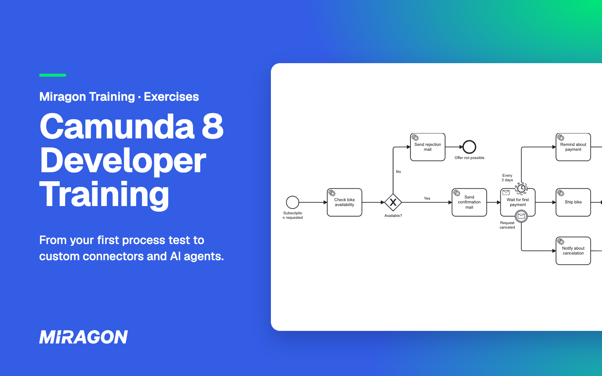

# Camunda 8 Developer Training – Exercises

[](LICENSE)



The hands-on part of Miragon's Camunda 8 developer training: four exercises you solve on your own machine, in Java, with Exercises 1 and 2 also in Kotlin.

## Why

You only trust a process once you have tested it, broken it and made it survive retries. Every exercise hands you working code for Miravelo, a bike shop, and one gap to close.

## What you get

- **Real code, not snippets.** Exercises 1 and 2 are complete Spring Boot services with BPMN models and a generated process API.
- **A full Camunda 8.10 stack.** One compose file starts Zeebe, Operate, Tasklist, Connectors and PostgreSQL.
- **A way out when you are stuck.** [Reference solutions](solutions) for Exercise 1, and a [Bruno](https://www.usebruno.com) collection in [`bruno/`](bruno) that calls the endpoints for you.

## The exercises

Start with the README in each exercise folder.

| # | You practise | Java | Kotlin | Solution |
| --- | --- | --- | --- | --- |
| 1 | Testing BPMN processes: paths, timers, messages | [exercise-1-testing-java](exercises/exercise-1-testing-java) | [exercise-1-testing-kotlin](exercises/exercise-1-testing-kotlin) | [Java](solutions/exercise-1-testing-java) · [Kotlin](solutions/exercise-1-testing-kotlin) |
| 2 | Outbox and idempotency, so no message and no retry goes wrong | [exercise-2-outbox-java](exercises/exercise-2-outbox-java) | [exercise-2-outbox-kotlin](exercises/exercise-2-outbox-kotlin) | not yet |
| 3 | Building your own outbound connector that keeps the BPMN domain-focused | [exercise-3-connector-java](exercises/exercise-3-connector-java) | – | not yet |
| 4 | Agentic orchestration: an AI agent picks the tools for a support request | [exercise-4-agentic-orchestration](exercises/exercise-4-agentic-orchestration) | – | not yet |

## Get started

You need JDK 21 and a running Docker or Podman. With Podman, point Testcontainers at its socket first, as [Testcontainers explains](https://java.testcontainers.org/supported_docker_environment/).

1. Clone the repo:

   ```bash
   git clone https://github.com/miragon-trainings/c8-developer-training-exercises.git
   cd c8-developer-training-exercises
   ```

2. Run the tests of Exercise 1. They start their own Camunda in a container, and the ones you write fail until you implement them:

   ```bash
   ./mvnw -pl exercises/exercise-1-testing-java test     # or exercise-1-testing-kotlin
   ```

3. From Exercise 2 on, start the stack and sign in at [localhost:8080](http://localhost:8080) with `demo` / `demo`:

   ```bash
   docker compose -f stack/docker-compose.yml up -d
   ```

Exercise 4 also calls a language model; its README names the options.

## Help and feedback

- **During the training:** ask your trainer.
- **Bugs and ideas:** [open an issue](https://github.com/miragon-trainings/c8-developer-training-exercises/issues).

## Contributing

Maintainers find the build, the generated process API and the solution conventions in [CLAUDE.md](CLAUDE.md).

## License

[MIT](LICENSE) © Miragon
